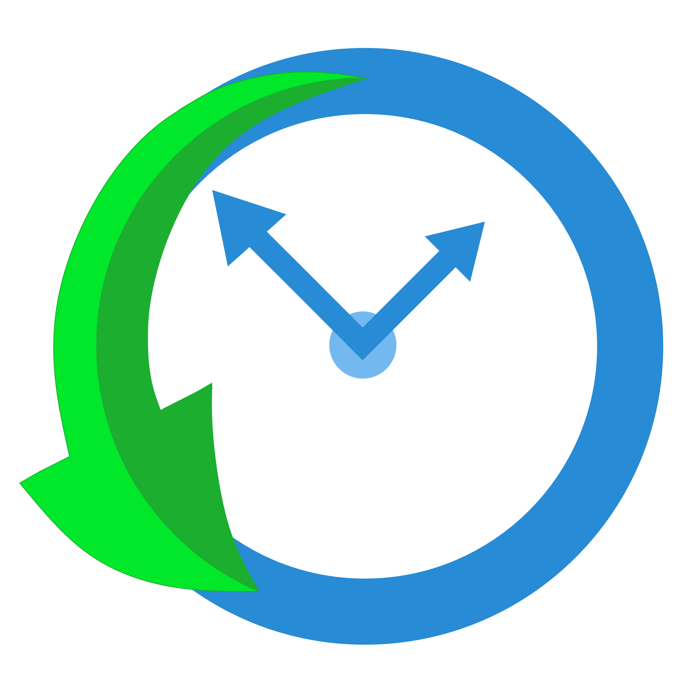

# Brand

Routine Notes is **the evolution app for ambitious people**. You build your day out of routines,
tick them inside their window, and the app turns that into a measurable score of how you are
evolving: Kinetics, Discipline and Geniuses. It competes with Todoist, TickTick and Notion, not
with family organisers. Routines matter more than tasks, and notes belong to the routine they
came from.

## Name

- Write it **Routine Notes**: two words, both capitalised, no "the", never "RoutineNotes" or "RN" in
  copy. The app's own header shows the page name ("Home", "Goals"), not the brand.
- The repository is still called `family-routine` for historical reasons. That name never
  appears in product or marketing copy, and nothing should be designed around "family".

## The mark

A clock face in brand blue whose two hands are arrows pointing up and outward, wrapped by a green
swoosh that turns back on itself: time, spent upward, coming round again every day.

| Part | Colour | Token |
|---|---|---|
| Clock ring and hands | `#288bd5` | `logo-blue` (= `primary`) |
| Centre dot | `#74b8f0` | `logo-blue-light` |
| Swoosh, bright face | `#00e829` | `logo-green` |
| Swoosh, shaded face | `#1bae2f` | `logo-green-dark` |

- Files: `assets/Logos/routine-notes-mark.png` (2090 px square, transparent) and
  `assets/Logos/routine-notes-app-icon-192.png` (the app icon). There is no vector master in
  the repo yet; use the PNG and do not redraw or trace it.
- Put the mark on white or `bg-app` (`#f4f4f4`). It has no single-colour or reversed version, so do
  not place it on primary blue or on a photograph.
- With the wordmark (marketing site header), the mark sits left of "Routine Notes" set in the
  display face at 600 weight, tight tracking, `ink-900`, turning `primary-dark` on hover. The gap is
  8 px; the site uses a 28 px mark beside 17 px text (`apps/web/src/components/Logo.astro`).
- The two logo greens belong to the mark only. The product's green is `success` (`#4CAF50`).

## The idea the design carries: K, D, G

Every tick feeds three scores, always in this order on product screens: **D, K, G**.

| | Name | Colour | What earns it | Marketing tagline |
|---|---|---|---|---|
| D | Discipline | `#4CAF50` | Ticking a routine inside its 1 h 30 m window (opens 60 min before the start, closes 30 min after) | "Punctuality wins." |
| K | Kinetics | `#E53935` | Ticking a routine's sub-tasks, paced every 2 hours | "Action under the hood." |
| G | Geniuses | `#2196F3` | Day goals that roll up into week, month and year goals | "Plans that compound." |

- In the app the three show as a trio of progress rings (`DkgRingTrio`), each with its letter
  inside. In marketing they are the three pillars of the K → D → G story, in blue tints
  (`primary`, `brand-400`, `brand-700`) rather than the product's red, green and blue.
- **The goal cascade.** A week goal ticks itself once 5 of its day milestones are met, a month goal
  at 3 week milestones, and a year goal at 6 month milestones, however many more were planned. The
  rule line under a goal says it the same way: "Needs 3 of 5 week milestones met". Never design a
  goal that waits for every milestone. (The marketing page still says "9 months a year"; the app's
  rule is 6.)

## Voice

Plain, specific and encouraging, written to someone who is already doing the work. The app is a
coach that has read your week, not a cheerleader.

- **Say what happened, then what it means.** Every toast is a title plus a consequence: "Routine
  ticked · D +10", "Workout moved to tomorrow · streak kept". A toast with no consequence has not
  been written yet.
- **Name things the way people do.** "Routine", "goal", "checklist", "week", "points". Not
  "entity", "task object", "sync".
- **Specific beats clever.** "You ticked 5 of 6 sessions; only Thursday slipped." beats "Great job
  this week!".
- **Lead with the win.** Never open with a count of late or missed sessions. Missed work gets a
  short make-up idea, not a scolding.
- **Short sentences, active voice.** A button says exactly what it does: "Start task", "Add all to
  checklist", "Skip today".
- **Honest about limits.** If the app cannot do something from where you are, say so and say where
  you can: "I can't move items from here. Tap the item, then use its date chips."
- **Points are earned, not bought.** Redeeming points is a late check-in with your agents still
  running. Never call it "the diamond", even though the points chip uses a diamond glyph.
- No emoji in UI copy. No exclamation marks except in a genuine celebration.

### Words

| Use | Avoid |
|---|---|
| routine, checklist, goal item, milestone | task object, entry, record |
| tick, ticked | complete the entity, mark as done (in buttons, "Done" is fine) |
| points | diamonds, credits, coins |
| agent | bot, AI worker |
| evolution, show up, compound | productivity hacks, crush it, hustle |
| skip a day | cheat day |

### Taglines in use

- "The evolution App for ambitious people." (site footer, store listing)
- "Show up daily. Evolve weekly." (site hero)
- "Start your evolution. Free." (closing call to action)
- "The app is free as long as you keep moving."

## Look

- **Product:** calm, bright and dense. White cards on `#f4f4f4`, one brand blue, orange for *now*,
  green for *done*. Colour carries state, not decoration. Type is Plus Jakarta Sans throughout;
  icons are Material Icons.
- **Marketing (apps/web):** the same blue on white with a deep navy ink (`ink-900` `#0d1b2a`),
  Montserrat for display headlines and Plus Jakarta Sans for body. Headlines may italicise one word
  in the display face ("Start your evolution. *Free.*") and may use a blue-to-blue gradient on the
  second line of the hero (`#288bd5` → `#5aa3d3` → `#288bd5`). That is the only gradient the brand
  uses.
- **Imagery:** real product screens in a phone, iPad mini or desktop frame. No stock photos of
  people at desks, no abstract 3D blobs, no purple. Sample people in screens are illustrated
  placeholders or licensed photos only (see `assets/README.md`).

## Do and don't

| Do | Don't |
|---|---|
| Put one primary action per surface in `primary` blue | Use the logo greens for buttons or success states |
| Show progress as rings and bars in the stimulus or status colour | Invent a new colour for a new state; reuse `now`, `success`, `danger-alt` |
| Keep the D/K/G order and colours fixed | Re-colour D, K or G for a theme |
| Show the goal rule in words under the bar | Make a goal look stuck at 3/5 when 3 is its threshold |
| Use the dark toast (`toast-bg`) for every notification | Add a second toast style, a snackbar or a top banner for feedback |
